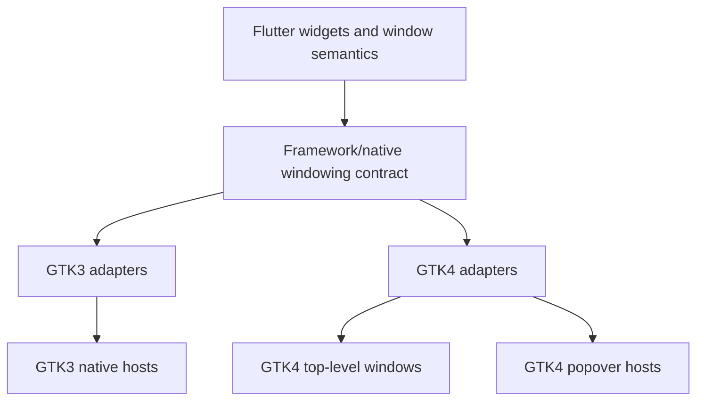

# RFC 430.0000: Staged GTK4 support for the Flutter Linux embedder

## Overview

Add an opt-in GTK4 Linux embedder. Keep GTK3 as the default during evaluation
and preserve its application and plugin contracts. Land GTK3 cleanup that
benefits the existing embedder on its own.

The immediate design question is whether Flutter's experimental windowing
interfaces can represent GTK4's native hosts and operations without committing
to GTK3-specific types and calling conventions. Review those contracts early so
GTK4 work can land in stages. This RFC asks reviewers to agree on the platform
interfaces and the criteria for expanding support.

The proposal builds on work tracked in [GTK4 support](https://github.com/flutter/flutter/issues/94804),
[multi-window support](https://github.com/flutter/flutter/issues/30701), and
the [downstream GTK4 implementation](https://github.com/flutter/flutter/pull/193405).

## Goals

- Make GTK4 selectable without changing existing GTK3 builds by default.
- Separate toolkit adapters so GTK3 preparation can be reviewed and tested alone.
- Preserve popup and top-level semantics across the framework/native boundary.
- Define native compatibility and plugin migration expectations explicitly.
- Require native integration tests in addition to unit and widget tests.

### Non-goals for initial adoption

- Removing GTK3, setting a removal date, or switching existing apps automatically.
- Loading both GTK major versions into one application process.
- Promising binary compatibility for existing GTK3 native plugins on GTK4.
- Requiring an opaque `_FlView` backend, a new object hierarchy, or runtime
  toolkit dispatch merely to extract existing callbacks.
- Introducing GTK4 stubs that imply unimplemented behavior is supported.
- Standardizing header bars, DMA-BUF presentation, or direct Wayland subsurfaces.
  These can be evaluated separately after the baseline is reliable.

## Background

Linux applications need consistent input, accessible controls, correct display
scaling, and native windows and popups across desktop environments. GTK4 offers
a different platform integration model that Flutter can use while continuing
to render its own content.

A concrete opportunity is fractional scaling. GTK4 exposes a double-valued
surface scale starting in 4.12, including changes during a surface's lifetime.
Its integer scale getter rounds upward. Flutter can propagate the fractional
value into rendering dimensions, device pixel ratio, input conversion, and
accessible geometry. [GdkSurface scale](https://docs.gtk.org/gdk4/method.Surface.get_scale.html).

A second opportunity is native transient surfaces. A GTK4 `GtkPopover`
implements `GtkNative` and derives directly from `GtkWidget`. It can host a
Flutter popup while GTK manages placement and dismissal. A contract that
requires a `GtkWindow` for every native host rules out popovers. [GtkPopover](https://docs.gtk.org/gtk4/class.Popover.html).

## Technical details

### 1. Select a toolkit at build time

Build each application against one GTK variant. Keep separate engine artifacts
and matching runner/plugin compilation settings. The downstream implementation
uses explicit `--linux-gtk=gtk3|gtk4` selection. Propose retaining that narrow
name: this selects between GTK implementations, whereas `--linux-embedder`
would suggest a broader backend-selection contract. Tooling should configure
the runner without requiring developers to edit generated files. Final CLI
spelling and project configuration remain subject to tool-maintainer review.
This rationale comes from the [implementation PR](https://github.com/flutter/flutter/pull/193405#flutter-tooling),
not an upstream API decision.

The concrete proposed selection contract follows the downstream
[variant-selection documentation](https://github.com/richyo-codes/flutter/blob/7359f41f8affca8d4f68570fc611e0b40179c60f/docs/platforms/desktop/linux-gtk-variant.md).
These are fork options proposed for review, not options available in upstream
Flutter today.

For `flutter run` and `flutter build linux`, resolve in this order:

| Priority | Setting | Scope |
| --- | --- | --- |
| 1 | `--linux-gtk=gtk3` or `--linux-gtk=gtk4` | Explicit invocation override. |
| 2 | `flutter.config.linux-gtk-default` in `pubspec.yaml` | Version-controlled project default. |
| 3 | `flutter config --linux-gtk-default=gtk3` or `gtk4` | Developer's global tool configuration. |
| 4 | `gtk3` | SDK fallback when no selection is configured. |

For example, a project can opt into GTK4 without repeating a flag:

```yaml
flutter:
  config:
    linux-gtk-default: gtk4
```

An explicit comparison run still overrides that project default:

```sh
flutter run -d linux --linux-gtk=gtk3
flutter build linux --linux-gtk=gtk4
```

Project and global values accept only `gtk3` or `gtk4`; invalid values should
produce actionable errors. Resolve the value once and propagate it to native
build configuration and the `FLUTTER_LINUX_GTK` Dart define. A conflicting manual
Dart define is rejected; it is not an independent toolkit selector. Use separate
build state (`build/linux` and `build/linux-gtk4` in the prototype), record the
variant in build metadata, and reject incompatible artifacts. Do not infer the
selection from installed dependencies.

The unified runner also has a lower-level CMake entry point: environment
`FLUTTER_LINUX_GTK`, then CMake variable `LINUX_GTK_VARIANT`, then GTK3. This is
not an environment override of the Flutter command: the tool supplies its
resolved variant to CMake. Prefer the tool or project setting so Dart and native
code cannot select different variants.

Template generation is a separate choice. The prototype supports:

```sh
flutter create --platforms=linux --linux-gtk=gtk3 example_gtk3
flutter create --platforms=linux --linux-gtk=gtk4 example_gtk4
flutter create --platforms=linux --linux-gtk=linux-gtk-unified example_unified
```

`linux-gtk-unified` selects a template, not a third runtime toolkit or a valid
pubspec default. GTK-specific templates preconfigure their respective runners;
the unified template supports either build selection. The experimental
`--linux-dir` create option controls runner placement, not GTK selection.
Changing a default does not port an existing runner or its native plugins.

SDK selection (including FVM), local-engine selection, and GTK variant selection
are distinct. A GTK4 pubspec setting neither downloads nor builds a GTK4 engine;
matching SDK, engine, host compiler, runner, and plugins must already be
available. The public prototype pin `e95aed6a2a35bdcc2242d944e08267b78f9ea317`
predates the local precedence fix `7359f41f8af`, so examples using that older
pin still need an explicit GTK4 flag. The precedence above describes the intended
contract and corrected local implementation.

Publish matching framework/tool, Dart SDK, and native engine artifacts with
reproducible pins. Community prebuilt artifacts support evaluation today; they
do not establish an upstream distribution or support commitment.

### 2. Separate adapters at existing boundaries

Retain shared Flutter lifecycle and engine logic where its semantics match.
Move GTK3-specific input, rendering, accessibility, and window adaptation into
focused implementation units as needed, with equivalent GTK4 units selected
by the build. Keep conditionals at actual integration boundaries rather than
scattering them through event handling.

An initial mechanical input extraction may share the unchanged private
`_FlView` instance definition. That private implementation choice is separate
from public plugin API and exported FFI ABI decisions. Preserve field layout,
initialization stages, ownership, and cleanup in such preparatory changes.
Avoid combining extraction with unrelated bug fixes or GTK4 enablement.



The diagram describes alternative builds, not runtime loading of both toolkits.
It does not prescribe a new C++ interface or backend allocation.

### 3. Preserve window and popup distinctions

Maintain separate responsibilities for view registration, native host identity,
and top-level window operations. A view hosted in a popover needs lifecycle,
focus, geometry, accessibility, and dismissal behavior without acquiring
operations that only make sense for a top-level window.

The existing GTK3 registration contract should remain intact until a replacement
or additive route is agreed. Do not simply widen `GtkWindow*` to an untyped
pointer while leaving consumers that cast it back to `GtkWindow`. Review the
whole producer/consumer chain, including native extensions.

Specify parent destruction, popup destruction, dismissal, focus restoration,
content sizing, and coordinate conversion. The toolkit/compositor may constrain
placement; requested placement must not be reported as observed placement when
it was adjusted. If adjusted geometry cannot be reported reliably, define that
limitation in the contract instead of inventing a result.

The prototype resolves a dialog opened from a GTK4 popup to the nearest
ancestor with a native top-level window. It hides ancestor popovers to release
their native grabs while keeping their Flutter views mounted. After the last
descendant dialog closes, it schedules surviving popovers to remap. Validate
nested popups, focus restoration, successive dialogs, and destruction of the
popup or its parent during modality.

### 4. Keep native interaction context in the embedder

GTK4 interactive move/resize uses a native device and surface-relative input
coordinates. Supplying only GTK3-style root coordinates and a timestamp is not
a sufficient portable contract. GTK4 supports these operations; their current
absence in a prototype is an implementation gap, not a GTK4 limitation.
See [GdkToplevel.begin_move](https://docs.gtk.org/gdk4/method.Toplevel.begin_move.html).

Propose routing a request through the embedder with a reference to the initiating
interaction. Review the representation before defining a public token type.
Specify expiry on release, cancellation, or host destruction, and an explicit
keyboard-initiated path. An application must not be able to reuse stale context
from another surface. Distinguish an unsupported operation, invalid context,
and a request that cannot be honored by the current window manager.

Similarly, describe visual intent rather than exporting GTK3's app-paintable
switch as a cross-toolkit guarantee. Capability queries can help applications
choose behavior, but operation results must still handle capabilities changing
or a compositor declining a request. Exact API names and result types remain
review questions.

### 5. Make native compatibility explicit

Keep three contracts distinct:

| Boundary | Proposed treatment |
| --- | --- |
| Experimental Dart windowing APIs | Review semantics and migration before depending on toolkit-specific behavior. |
| Exported framework/native FFI | Define matching-version expectations; preserve existing entry points when adding incompatible signatures. |
| Private `_FlView` implementation | Keep ownership local; internal extraction does not create a public ABI promise. |

Two downstream changes demonstrate why names alone are insufficient:

- Upstream snapshot `6597889f57b4922b95b3917967f8530fcbdd9515` declares
  `fl_view_monitor_new(view, on_first_frame)`. Downstream snapshot
  `7359f41f8affca8d4f68570fc611e0b40179c60f` adds a size callback parameter.
  An old caller cannot safely assume the new implementation has the old ABI.
- GTK3 `GdkRGBA` uses doubles; GTK4 uses floats. Framework FFI must not reuse the
  GTK3 layout with GTK4. Prefer an explicitly defined toolkit-independent color
  representation at a new boundary, converted within the embedder, while
  preserving existing public entry points where required.
  See [GTK3 RGBA](https://docs.gtk.org/gdk3/struct.RGBA.html) and
  [GTK4 RGBA](https://docs.gtk.org/gdk4/struct.RGBA.html).

For initial evaluation, require matched framework/native builds. If maintainers
want compatibility across versions, agree on versioned entry points or an
extensible interface before changing signatures. Do not assume internal FFI
has a stable ABI today, or turn its exported symbols into a stable plugin API
accidentally. These downstream mismatches are not evidence of an upstream bug.

#### Plugin source compatibility through C/C++ preprocessor flags

A plugin can keep one source package with conditional native adapters for each
GTK major. The downstream runner templates export `FLUTTER_LINUX_GTK3` or
`FLUTTER_LINUX_GTK4` through the `flutter` CMake interface target. A plugin linking
that target inherits the selected definition, include paths, and link requirements:

```cmake
# Runner-generated Flutter target: exactly one definition for the selected GTK.
target_compile_definitions(flutter INTERFACE FLUTTER_LINUX_GTK4)

# Plugin target consumes Flutter's build requirements.
target_link_libraries(${PLUGIN_NAME} PRIVATE flutter)
```

The GTK3 template exports `FLUTTER_LINUX_GTK3`; the unified template derives the
single definition from the resolved variant. These settings belong in generated
Flutter build configuration, not in plugin code that independently chooses a
GTK major. See the downstream [unified Flutter CMake target](https://github.com/richyo-codes/flutter/blob/7359f41f8affca8d4f68570fc611e0b40179c60f/packages/flutter_tools/templates/app/linux-gtk-unified.tmpl/flutter/CMakeLists.txt).

For example, a small native adapter can preserve the existing GTK3 path:

```cpp
#include <gtk/gtk.h>

#if defined(FLUTTER_LINUX_GTK3) && defined(FLUTTER_LINUX_GTK4)
#error "Select exactly one GTK major"
#endif

static GtkWindow* GetParentWindow(GtkWidget* widget) {
#if defined(FLUTTER_LINUX_GTK4)
  GtkRoot* root = gtk_widget_get_root(widget);
#else
  // Also supports older GTK3 Flutter SDKs that export neither definition.
  GtkWidget* root = gtk_widget_get_toplevel(widget);
#endif
  return GTK_IS_WINDOW(root) ? GTK_WINDOW(root) : nullptr;
}
```

This example finds a parent window for a window-specific operation; it must not
be used as the identity of a popup's own native host. Keep conditional sections
small, or select separate source files when the adapters diverge substantially.
The flags are compile-time toolkit selection, not checks for optional runtime
APIs or permission to mix GTK majors in a process. Where older custom GTK4
runners do not export them, the cited projects also demonstrate fallback checks
using `GTK_MAJOR_VERSION`; that identifies the headers being compiled against,
not the installed runtime's complete capabilities.

Two public downstream projects illustrate migration patterns:

| Project | Examples and design implications |
| --- | --- |
| [Flutter packages fork, `feat-add-gtk4-support-v7`](https://github.com/richyo-codes/packages/tree/feat-add-gtk4-support-v7) | [File selector](https://github.com/richyo-codes/packages/blob/3c47c005a32ecdd1baf6b021a09236548eb60909/packages/file_selector/file_selector_linux/linux/file_selector_plugin.cc) selects GTK4 dialog code with `FLUTTER_LINUX_GTK4`; [URL launcher](https://github.com/richyo-codes/packages/blob/3c47c005a32ecdd1baf6b021a09236548eb60909/packages/url_launcher/url_launcher_linux/linux/url_launcher_plugin.cc) selects a GIO launch path for GTK4 and retains its GTK3 path. |
| [media-kit fork, `integration/gtk4-review`](https://github.com/richyo-codes/media-kit/tree/integration/gtk4-review) | [Video output](https://github.com/richyo-codes/media-kit/blob/224d1d55c1dcf5be445e932e25d6222b408ed2d3/media_kit_video/linux/video_output.cc) uses the flags to select the GTK4 shared EGL context and texture lifecycle, with a header-version fallback when neither flag exists. Its [plugin CMake target](https://github.com/richyo-codes/media-kit/blob/224d1d55c1dcf5be445e932e25d6222b408ed2d3/media_kit_video/linux/CMakeLists.txt) links `flutter` to consume the build configuration. |

The linked commits show how each plugin selects its GTK-specific code. File
selector's asynchronous GTK4 dialogs need lifecycle and minimum-API testing.
Media Kit's EGL context sharing and playback recovery need graphics validation,
including a separate test with the experimental Vulkan texture bridge.

Source conditionals enable a plugin to build for either toolkit; they do not
make an existing GTK3 binary compatible with GTK4. Plugins must avoid hard-coded
GTK3 dependency lookup in GTK4 builds, ensure the macro agrees with their GTK
headers and engine library, and test both builds. Independently compiled native
dependencies do not inherit CMake definitions automatically. Public headers that
expose conditional GTK types also require consistent settings for their consumers.

The flags are a concrete migration mechanism, not a declaration that every
plugin supports both variants. A way to declare or validate plugin toolkit
compatibility and diagnose mismatches remains a tooling question. Plugins that
do not use GTK still need representative build coverage.

### 6. Separate the build baseline from optional runtime capabilities

The [implementation PR](https://github.com/flutter/flutter/pull/193405#runtime-gtk4-capability-bindings)
proposes compiling against a conservative GTK4 baseline while binding newer
APIs at runtime. Adopt this as the proposed compatibility approach for review,
rather than implicitly raising the minimum GTK version whenever the embedder
uses a newer accessibility or presentation feature.

Resolve optional symbols from the GTK/GDK libraries already loaded. Group them
by the complete operation they enable; one available entry point does not imply
that its companion functions, types, or interfaces are usable. Keep typed ABI
declarations and version requirements in a small audited layer. Hand-maintained
declarations must be checked against the corresponding upstream headers.

Validate absent and incomplete capability sets, the oldest supported runtime,
and newer runtimes. Check that optional symbols have not become mandatory link
dependencies. This approach adds ABI and test maintenance; raising the baseline
is preferable if the fallback cannot satisfy the supported behavior contract.

In particular, an application starting successfully on an older GTK runtime is
not proof that its accessibility is usable. Publish a capability matrix and
agree on the minimum hierarchy, text, action, and announcement behavior required
for support. Optional enhancements may degrade gracefully; essential access
must not silently disappear. The exact minimum GTK version remains unresolved.

#### Distribution examples and incremental runtime features

Package records checked on 2026-11-14 illustrate the value and limits of the
runtime binding approach. The table uses the prototype's GTK 4.8 build baseline;
it does not settle the final minimum supported GTK version or commit Flutter to
supporting every listed distribution. Entries describe API eligibility, not
cross-distribution runtime validation or complete accessibility parity. Packages
must be installed, and minor/EUS channels and backports can differ.

| Distribution / repository | GTK4 version | Meets 4.8 build baseline | Native accessibility tree 4.10 | Text, announcements, DMA-BUF and offload 4.14 | Platform-state notifications 4.18 | AT caret/selection commands 4.22 | Frame outcome telemetry 4.24 |
| --- | --- | --- | --- | --- | --- | --- | --- |
| [Ubuntu 22.04 LTS, updates](https://packages.ubuntu.com/jammy-updates/libgtk-4-1) | 4.6.9 | Below baseline | — | — | — | — | — |
| [Ubuntu 24.04 LTS, updates](https://packages.ubuntu.com/noble-updates/libgtk-4-1) | 4.14.5 | Yes | Yes | Eligible | No | No | No |
| [Ubuntu 26.04 LTS, updates](https://packages.ubuntu.com/resolute-updates/libgtk-4-1) | 4.22.4 | Yes | Yes | Eligible | Yes | Yes | No |
| [Ubuntu 26.10](https://packages.ubuntu.com/stonking/libgtk-4-1) | 4.24.1 | Yes | Yes | Eligible | Yes | Yes | Yes |
| [RHEL 9.4 update record¹](https://linux.web.cern.ch/updates/rhel9/prod/2024/05/monthly_updates/) | 4.12.3 | Yes | Yes | No | No | No | No |
| [RHEL 10.2 update record²](https://linux.web.cern.ch/updates/rhel10/prod/2026/10/monthly_updates/) | 4.16.7 | Yes | Yes | Eligible | No | No | No |
| [Fedora 43, stable package](https://packages.fedoraproject.org/pkgs/gtk4/gtk4/) | 4.20.4 | Yes | Yes | Eligible | Yes | No | No |
| [Fedora 44, stable package](https://packages.fedoraproject.org/pkgs/gtk4/gtk4/) | 4.22.5 | Yes | Yes | Eligible | Yes | Yes | No |
| [Fedora 45, stable package](https://packages.fedoraproject.org/pkgs/gtk4/gtk4/) | 4.24.1 | Yes | Yes | Eligible | Yes | Yes | Yes |
| [Debian 12, bookworm](https://packages.debian.org/bookworm/libgtk-4-1) | 4.8.3 | Yes | Fallback | No | No | No | No |
| [Debian 13, trixie](https://packages.debian.org/trixie/libgtk-4-1) | 4.18.6 | Yes | Yes | Eligible | Yes | No | No |

¹ CERN's RHEL 9 repository update record identifies `gtk4-4.12.3-2.el9`
and links Red Hat advisory RHBA-2024:2248. This confirms the package in that
RHEL update stream, rather than inferring it solely from a rebuild distribution.
Do not assume every minor/EUS channel has the same package; older EL9 systems
can be below 4.8. CentOS Stream 9 and Rocky 9.4 also publish the 4.12.3 line.

² CERN's October 2026 RHEL 10 update record identifies
`gtk4-4.16.7-5.el10_2` with Red Hat advisory RHBA-2026:76616. The 4.16.7 line is
also verified in the official CentOS Stream 10 spec and Oracle Linux advisory.
This does not assign that exact build to every RHEL 10 EUS channel.

GTK 4.12 also supplies fractional surface scale and GTK 4.14 fractional monitor
scale. GTK 4.16 introduces accessible-text geometry interface slots; the current
backend checks their ABI but does not implement those callbacks. A newer GTK
version therefore must not imply a benefit the adapter has not implemented.

DMA-BUF and graphics-offload eligibility still require suitable devices,
formats/modifiers, scene contents and compositor support. Graphics offload is
opt-in; an available wrapper does not establish accepted offload or a speedup.
GTK 4.24's explicit frame outcomes improve benchmark interpretation. The
prototype collects them only when requested in debug/profile builds; release
and JIT-release builds contain none of this collector or its optional timing
symbol lookup. GTK surface feedback is not an exact map of Flutter frames or
proof of direct scanout. Older runtimes retain their available timing fields
with unknown outcomes.

For Flatpak and other bundles, use the loaded runtime's GTK, not the host
release's package version. Distribution names do not select capabilities;
the complete required symbol set and version checks do. A host upgrade and an
application-runtime upgrade can consequently enable different feature sets.

### 7. Preserve semantics identity through the GTK accessibility adapter

Use GTK4's accessibility interfaces for the initial GTK4 backend. Keep Flutter
semantics storage and update processing separate from toolkit objects where
practical. Incremental updates should preserve unaffected objects and links,
handle reordered children, and remove unreachable nodes. Stable native identity
helps assistive technology retain its position while Flutter updates the UI;
retained objects still need safe behavior after their semantics node disappears.

The prototype preserves parent accessibility contexts during tree updates.
Native AT-SPI tests check window ancestry, then exercise a hide/remap sequence
where the hidden view disappears from traversal and a retained button keeps
its identity when the view is mapped again. Visibility, geometry, object
identity, and safe access after destruction each require their own assertions.

The [PR's accessibility design](https://github.com/flutter/flutter/pull/193405#accessibility)
also motivates runtime-gated text content, caret/selection state, attributes,
text geometry and change notifications, plus announcements. Review these as
capability groups with explicit fallback behavior rather than promising identical
features on every GTK4 release. Password handling applies to every text and
notification path, including cached or retained objects.

This is distinct from [issue #159460](https://github.com/flutter/flutter/issues/159460),
which proposes replacing Flutter's ATK use with direct AT-SPI communication.
Here, GTK supplies the native accessibility integration; Flutter does not add
its own D-Bus accessibility backend. Shared semantics maintenance might help a
future direct backend, but neither its implementation nor approval is implied.

### 8. Rendering and presentation

Flutter renders each frame. GTK's GSK renderer composites it with the rest of
the window. The buffer handoff between them can use a shared texture, a DMA-BUF,
or CPU readback. Keep a tested fallback for each optional path. Across resize
and teardown, producers and consumers must synchronize access and retain buffers
until the last reader finishes.

#### Flutter renderer

| `FLUTTER_LINUX_RENDERER` | Prototype behavior |
| --- | --- |
| Unset or `opengl` | Use OpenGL, the default. |
| `software` | Use software rendering. |
| `vulkan` | Require Impeller Vulkan. Enable Flutter GPU separately to use compute. |
| `auto` | Try Vulkan before choosing the view compositor. Use OpenGL if the embedder lacks Vulkan support, the device cannot initialize, or engine switches explicitly disable Impeller. Report later startup and texture import errors on the selected backend. |

#### GTK composition

`GSK_RENDERER` selects GTK's renderer. For example, `GSK_RENDERER=vulkan`
runs GTK composition on Vulkan while Flutter can still render with OpenGL.
New GTK4 runners on GTK 4.16 or later prefer GSK GL for the ordinary OpenGL
texture path on Wayland. An explicit `GSK_RENDERER` takes precedence. Selecting
Flutter Vulkan, software, DMA-BUF export, or graphics offload bypasses the runner
preference. Existing runners keep their own startup policy.

The runner's Wayland check accepts an unset `GDK_BACKEND` or the literal value
`wayland`. An ordered list such as `wayland,x11` bypasses the preference even
if GTK chooses Wayland. [GTK runtime settings](https://docs.gtk.org/gtk4/running.html).

#### Buffer handoff and optional offload

- **OpenGL texture handoff.** Ordinary GTK4 texture views bypass Flutter's
  optional direct Wayland subsurface renderer. The OpenGL DMA-BUF export path
  blits the framebuffer into an EGLImage-backed snapshot before exporting it.
- **Vulkan texture handoff.** The engine can copy a full-frame layer or a
  GPU-composited set of pixel-aligned layers into a linear DMA-BUF. It waits for
  the copy to finish before handing the buffer to GTK. The pool can reuse a
  buffer after GTK releases it and reader synchronization permits reuse. Export
  or import failure falls back to readback. Fractional layer placement or failed
  GPU composition falls back to CPU composition.
- **GTK graphics offload.** `FLUTTER_GTK4_ENABLE_GRAPHICS_OFFLOAD=1` requests a
  `GtkGraphicsOffload` wrapper and enables the DMA-BUF path unless
  `FLUTTER_GTK4_ENABLE_DMABUF` is explicitly set. The wrapper requires GTK 4.14
  and its runtime symbol. Input and accessibility stay on the render widget.
  GTK decides whether the scene and buffer format support offload and can fall
  back to normal composition. Check GTK diagnostics and actual buffer
  attachments on GTK's child Wayland surface to verify handoff. Measuring
  direct scanout or latency requires separate evidence.

Pixel-buffer plugins can upload RGBA frames through Vulkan. The opt-in
`FLUTTER_GTK4_VULKAN_GL_TEXTURES=1` bridge copies a framebuffer-readable
`GL_TEXTURE_2D` into a DMA-BUF shared with Vulkan. The engine checks Vulkan
export support, EGL import support, and GL context capabilities before accepting
registration. With the bridge enabled, plugins such as Media Kit video can
keep producing OpenGL textures while Impeller samples the shared image in
Vulkan, provided the texture and driver meet those requirements. That path
still needs end-to-end plugin testing and driver coverage.

#### Frame pacing and shutdown

The prototype selects the pacing policy at startup on both GTK3 and GTK4.
`FLUTTER_LINUX_FRAME_PACER=gtk` is the branch default and uses the implicit
view's GTK frame clock with timer recovery when it is unmapped or stalls.
`FLUTTER_LINUX_FRAME_PACER=engine` uses the engine's 60 Hz fallback. A visible
secondary view cannot yet take over as the clock source. Treat selection of a
production policy as a separate decision backed by display-refresh and
multi-window testing.

The timing collector follows GTK pacer ticks, so its samples can miss feedback
that arrives after the last tick. Compare pacing policies with a measurement
source available to both and report unknown or pending presentation outcomes
separately. A 2026-11-14 functional smoke exercised GTK4 Vulkan tracing, but
host load and incomplete GPU counter coverage prevented an accepted performance
comparison.

The prototype closes admission to new native work and synchronously stops the
engine during application shutdown, even when plugins retain engine references.
It drains accepted vsync requests before embedder shutdown. A separate shared
embedder change reclaims canceled vsync tokens. Review these changes
independently of GTK4 adoption. In a recorded GTK3 Xvfb/llvmpipe comparison with
engine pacing, the raster thread was still alive at application return in all
six runs with the shutdown hook disabled and in none of the six with it enabled.
All runs exited successfully. The Fedora KDE/Radeon crash still needs validation
with the original reproducer and affected hardware.
[Flutter issue #189379](https://github.com/flutter/flutter/issues/189379).

### 9. Set explicit correctness and support gates

Propagate one consistent surface scale through physical render targets, Flutter
metrics, pointer/touch/scroll conversion, popup geometry, and accessibility.
Test rounding with odd-sized views and monitor changes that leave the rounded
integer scale unchanged. GTK4 version requirements must be chosen against
Flutter's supported distributions and the capability policy above; this draft
does not choose a minimum.

Treat the GTK accessibility implementation as a separate adapter over Flutter
semantics. Preserve text, actions, focus, and password confidentiality. Test
removal/reparenting and callbacks while assistive technology retains references,
including after view destruction. Matching GTK3's tests alone is insufficient
when GTK4 has a different lifecycle or can expose richer semantics.

Rendering must cover frame lifetime and synchronization, resizing, external
textures, and software/hardware configurations. Skia/Impeller selection and
GTK's own renderer are separate variables; a requested renderer that falls
back does not count as validation of the requested path.

### Prototype evidence and its limits

The [implementation PR description](https://github.com/flutter/flutter/pull/193405)
was reviewed on 2026-10-21 at PR head
`e95aed6a2a35bdcc2242d944e08267b78f9ea317`. Its architecture and rationale inform
this proposal; descriptions of implementation and test scope do not independently
prove runtime correctness. No human review comments or approvals were present
when checked. Later local fixes and results below are separate evidence.
The November implementation review used local branch head `553c6884e97`,
with the renderer and texture-bridge follow-up reviewed through `d9fcf893e37`.

The downstream prototype is useful feasibility evidence, with the following
limits. These are recorded prior results, not fresh full-engine validation
performed while writing this RFC.

| Area | Evidence | What remains |
| --- | --- | --- |
| Native popups | A private headless Sway session observed Wayland popup creation, dismissal, reopening, and content resizing. | Popup text input/focus, nested popups, broader desktop coverage, and residual animation behavior. |
| Parent sizing | A regression reduced an 800×600 parent to approximately 244×160; selecting the nearest native host preserved the parent size. | Revalidate with newly published complete engine builds. |
| Popup shrinking | A retained render texture prevented shrink; a focused measurement test failed before the fix and passed after it. Native tests then observed shrink after the animation peak. | Visual smoothness is not established by a sizing assertion. |
| Fractional scale | Recorded headless tests covered 125%, 150%, 175%, scale changes, monitor movement, input, render dimensions, and AT-SPI bounds. | Physical displays, more compositors, and actual hardware renderer combinations. |
| Distribution | The public pinned SDK and precompiled engines built the multi-window app in GTK4 debug and release modes. | The public artifact pin predates the recent popup fixes; publish matching replacements before advertising a corrected demo. |

Sway is the reproducible test compositor, not the identified cause of the sizing
bugs. Test both floating and tiled parents because tiling can mask size requests.
A widget test cannot establish that a native popup exists, receives focus, or
survives assistive-technology references correctly.

The recent popup fixes were also tested using an engine relinked from cached
objects. That is narrower evidence than a clean full build. Before submission,
attach a public, pinned reproduction and results for a complete rebuilt SDK;
reviewers should not need private checkout paths or unpublished binaries.

## Testing

For each affected implementation, combine unit tests, engine-boundary tests,
and isolated native integration tests. Include Wayland and X11; keyboard/IME,
mouse, touch, scrolling and cancellation; popup focus/dismissal and parent
lifetime; AT-SPI actions/text/bounds/passwords and retained-reference teardown;
fractional scaling and monitor transitions; external texture and frame lifetime.
Use ASan-capable native test builds where supported to catch lifetime errors.
Run GTK3 regressions throughout, not only when its files visibly change.

The proposed release gate is reproducible results with declared SDK/engine,
GTK, compositor, renderer, and plugin versions, plus no known blocking input,
accessibility, or lifetime defects in the advertised feature set. Required
hardware coverage and performance thresholds need maintainer agreement.
Measure frame pacing, CPU/GPU cost, memory, and startup against GTK3 on the same
application and hardware before making performance claims.

### Performance and high-refresh testing

In a local GNOME/Mutter comparison, the heaviest workload ran at about 31
frames/s on GTK3 and 32–33 frames/s on the GTK4 variants. The 45 retained runs
covered three workloads and five presentation configurations, all with a
1280×720 viewport and Impeller OpenGL. The memory comparison remains open.

A separate release scroll test used Impeller OpenGL and GTK frame pacing on
a virtual Weston output. Both toolkits came close to the 60 and 144 Hz output
rates. At 240 Hz, GTK3 delivered about 240 frames/s and ordinary GTK4 delivered
161–164 frames/s. In the second GTK4 run, Weston reported presenting all 3,282
surface commits. Fewer frames reached the compositor, and the cause is still
open. In a separate run of the optional direct-subsurface path, Weston reported
discarding all commits on the child surface.

The author has no physical high-refresh monitor available for testing.
**Help wanted.** If you have a 144 Hz or faster Wayland display, especially
240 Hz, please compare the same release scroll workload with GTK3 and GTK4 on
the same machine. Reports from both smooth and uneven runs help establish
whether the virtual-output result reproduces on hardware. Record the active
refresh rate, compositor and version, GPU and driver, engine revision, and
renderer settings. If you can capture presentation feedback, include frame
intervals and counts of submitted, presented, and discarded frames. Report
ordinary GTK4 texture presentation and optional direct-subsurface runs
separately. [Linux frame pacing tracking issue](https://github.com/flutter/flutter/issues/191245).

## Rollout

Land and review these stages independently:

1. **GTK3 preparation:** behavior-preserving extraction and tests, with existing
   GTK3 targets green. No GTK4 dependencies in these PRs.
2. **Windowing contract agreement:** review native hosts, interaction context,
   color/layout conversion, and FFI compatibility. GTK3-compatible improvements
   can land independently of GTK4 when their value and contract are established.
3. **Experimental GTK4 enablement:** explicit selection, separate artifacts,
   runner/plugin checks, and documented limitations. Keep GTK3 as the default.
4. **Support decision:** require agreed CI coverage and ownership before changing
   defaults or expanding support claims. Any GTK3 deprecation is a later decision.

During evaluation, rebuild with GTK3 and GTK3-compatible plugins to roll back.
Keep optional rendering experiments disabled by default until reviewers accept
them individually.

## Alternatives Considered

- **Continue with GTK3 only:** avoids a second backend and CI matrix, but leaves
  GTK4 integration external and does not address assumptions that restrict
  future windowing hosts. This remains viable if upstream maintenance cannot
  be staffed.
- **Replace GTK3 immediately:** reduces long-term duplication but imposes plugin,
  distribution, and behavior migration before sufficient validation exists.
- **Maintain a downstream embedder indefinitely:** allows faster experimentation
  but duplicates platform maintenance and leaves framework/native contracts
  dependent on a fork. The prototype remains useful even if upstream declines.
- **Use in-view Flutter overlays for every popup:** appropriate for many widgets,
  but not an equivalent implementation of a separately hosted native popup.
- **Introduce a large generic backend abstraction first:** may ultimately help,
  but increases the scope of preparatory patches before the shared semantics
  are settled. Start at observed boundaries and reassess after extraction.

The staged approach costs additional build/test coverage and temporary adapter
duplication. That cost requires explicit maintainer and infrastructure ownership;
community artifacts alone cannot meet it. Toolkit-neutral contracts also require
care not to erase capabilities that applications actually need.

## Questions for reviewers

1. Is an opt-in GTK4 backend with GTK3 retained the preferred upstream direction?
2. Can native view/host registration be separated from top-level operations
   before the experimental windowing contracts settle?
3. What interaction-context and operation-result contract should move/resize use,
   including keyboard initiation and cancellation?
4. Are matched framework/native builds sufficient, or is cross-version FFI
   compatibility required? Which interfaces, if any, should become public?
5. Which GTK versions/distributions and plugin migration mechanism are acceptable?
6. Is the proposed optional-runtime binding layer acceptable, and which
   accessibility capabilities must be guaranteed by the minimum supported GTK?
7. Who can shepherd desktop integration and review widgets, accessibility, tools,
   plugins, and artifact infrastructure? What are the required promotion gates?

A decision on questions 2–4 would allow focused preparation to proceed even
while GTK4 support and maintenance commitments remain under discussion.
